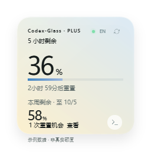

# Codex-Glass

Windows 桌面额度浮窗 · 轻量渲染版 · 版本：3.1.1 · 更新日期：2026-10-01

在桌面上查看本机 Codex 账号的剩余额度，支持随 Codex / ChatGPT 客户端显示、隐藏。提供 180 / 200 / 220 / 240 四档卡片，以及悬停展开的小浮球。

**第一次使用，从下面的“快速开始”操作即可。** 开发、源码运行与打包方法见 [开发说明](DEVELOPMENT.md)；已完成的验证及限制见 [验证记录](design-qa.md)。

## 下载

**[下载最新 Windows 安装包](https://github.com/LonngLonngwj/Codex-Glass/releases/latest)** · [3.1.1 安装 EXE](https://github.com/LonngLonngwj/Codex-Glass/releases/download/v3.1.1/Codex-Glass-3.1.1-Windows-x64-Setup.exe) · [SHA-256 校验文件](https://github.com/LonngLonngwj/Codex-Glass/releases/download/v3.1.1/Codex-Glass-3.1.1-Windows-x64-Setup.exe.sha256)

普通使用请下载 Release 中的 **Setup.exe**，双击安装。GitHub 的“Code → Download ZIP”是源码，不包含已构建的运行程序。安装包约 139 MB，已经附带 Python / Qt 运行库、离线说明、GPL 项目源码与依赖的对应源码。默认安装到当前用户目录，无需管理员权限。

支持 Windows 10 1809 及以上 / Windows 11，64 位；当前实际安装验证环境是 Windows 11 x64。真实额度需要本机有可用、已登录的 Codex CLI。跟随 ChatGPT 只控制浮窗何时显示，显示的数据仍然是 Codex 额度。

这是独立社区工具，与 OpenAI 没有隶属关系。

## 1. 快速开始

### 安装包（推荐分享）

双击 **Codex-Glass-3.1.1-Windows-x64-Setup.exe**，按向导安装。安装到当前用户目录，无需管理员权限；桌面快捷方式和登录 Windows 自动守候为可选项。完成后从开始菜单运行 Codex-Glass。

安装版自带 Python 和 Qt；真实额度仍需要接收者本机可用、已登录的 Codex CLI。详细安装、分享、许可和卸载说明见 [分享说明](SHARING.md)。安装后使用说明也可从开始菜单离线查看。

### 便携版准备与启动

1. 将整个 ZIP 解压到一个准备长期保留的文件夹。
2. 打开 `app/Codex-Glass/`，双击 **`Codex-Glass.exe`**。
3. 打开 Codex 客户端，等待浮窗同步。读取过程中刷新按钮会暂时禁用；单次读取超时为 20 秒。
4. 右键卡片，或点击右下角圆形菜单，按需要调整大小与跟随目标。

便携包自带 Python、Qt 和运行库，**无需自行安装 Python**。必须保留 `Codex-Glass.exe` 与同目录的 `_internal` 文件夹；只复制 EXE 会导致无法运行。程序不包含 Codex CLI，额度读取需要本机已有可用、已登录的 Codex CLI。

新配置默认是：200 × 200 完整卡片、浅色、置顶、跟随 Codex 或 ChatGPT、低额度提醒开启。更新已有版本时会继续使用你保存的设置。

### 设置为“仅跟随 Codex”

在浮窗菜单中选择：

- **跟随哪个客户端 → 仅 Codex**。
- 勾选 **跟随客户端显示 / 隐藏**。
- 勾选 **登录 Windows 后自动守候**。

这样，登录 Windows 后程序在后台守候；检测到 Codex 运行时显示卡片，Codex 完整退出后隐藏，再次启动 Codex 时约 3 秒内重新显示。

### 从 Codex 托管终端启动

普通使用优先通过文件资源管理器双击 EXE。如果从 Codex 等客户端托管的终端启动，进入解压后的 `Codex-Glass` 目录，执行：

```powershell
# 独立启动，并登记当前用户的登录启动项
.\source\start-independent.ps1 -EnableStartup

# 只独立启动，不修改启动项
.\source\start-independent.ps1
```

这个启动器通过 Windows 独立创建进程，避免浮窗随托管终端的宿主一起结束，也避免读取宿主重定向的设置目录。使用普通资源管理器启动、从浮窗菜单设置登录启动时，不需要这个步骤。如果系统不允许运行脚本，直接双击 EXE 即可。

## 2. 看懂卡片



上图为程序导出的**示例数据**，不是账号的实时额度。

| 区域 | 含义 |
|---|---|
| `Codex-Glass · 套餐` | 服务端返回的套餐名称；没有返回时只显示 Codex-Glass |
| 大百分比 | 短周期剩余额度，通常为 5 小时额度 |
| 渐变进度条 | 同一额度的剩余比例 |
| “……后重置” | 距服务端给出的重置时间还有多久 |
| “本周剩余 · 至 ……” | 长周期额度与重置日期，通常为每周额度 |
| “重置机会 · 查看” | 服务端返回的可用重置次数与到期时间；字段可用时显示 |
| 顶部小圆点 | 同步状态；悬停可看简短状态和同步时间 |

**数字表示剩余比例。** 例如服务端报告已用 60%，卡片显示剩余 40%。周期长度、套餐、次数及日期以实际返回数据为准。

- 绿色点表示正常状态；最近观察到同一周期额度下降时轻微脉冲三次。
- 同步过程中圆点变为灰青色，刷新按钮暂时禁用。
- 同步失败或数据较旧时圆点变为偏棕色，并保留上次成功的数据、标注上次同步时间。
- `—` 表示没有可用数据，或周期已过期而新数据尚未返回；不能把它当成 0% 或 100%。

额度默认每 **60 秒**查询一次。消耗提示来自两次查询之间的变化，无法表示瞬时使用状态。点击“查看”只展示重置机会，兑换仍需在 Codex 客户端中操作。

**跟随 ChatGPT 只控制浮窗的显示条件。** 当前读取的是 Codex 账号订阅额度，不是普通 ChatGPT 各模型的消息次数。仅安装 ChatGPT 而没有可用的 Codex CLI 时，浮窗可能显示暂无数据。

## 3. 大小、外观与双屏

### 选择固定大小

右键卡片 → **卡片大小**，选择 180 / 200 / 220 / 240。切换立即生效并保存；默认 200。小浮球始终为 72 × 72，不随卡片档位改变。

这里的尺寸是卡片的**逻辑像素**。Windows 会根据显示器缩放换算成物理像素：

| 档位 | 100% 缩放 | 150% 缩放 |
|---|---:|---:|
| 180 | 180 × 180 | 270 × 270 |
| 200（默认） | 200 × 200 | 300 × 300 |
| 220 | 220 × 220 | 330 × 330 |
| 240 | 240 × 240 | 360 × 360 |

阴影还需要额外透明边缘，所以 200 档的完整窗口画布为 256 × 268 逻辑像素。透明边缘不拦截桌面点击。

对于外接 1920 × 1080、100% 缩放与笔记本 2560 × 1600、150% 缩放的组合，200 档到笔记本上会使用 300 × 300 物理像素；回到外接屏应恢复 200 × 200，不应反复拖动后越来越大。显示器分辨率和 Windows 缩放比例是两个不同设置。

### 卡片和小浮球

- **完整卡片**：同时查看短周期、每周额度和重置信息。
- **小浮球**：显示短周期百分比；悬停展开为当前档位的完整卡片，移开约 320ms 后收回。
- 右下角菜单或“显示形态”菜单可切换两种模式。

### 颜色与质感

短周期剩余 ≥ 50% 时为浅蓝色，10% < 剩余 < 50% 时为奶油色，剩余 ≤ 10% 时为暖桃色。菜单“外观”可切换浅色和深色。

卡片使用平滑超椭圆近似、高光轮廓、柔和阴影和约 97% 不透明度的渐变底色。200 档的圆角尺度约为 28.3px。当前质感是柔雾渐变，**没有实时模糊桌面背景**。文字按屏幕 DPI 绘制，小字号中文保持至少 10px。

## 4. 操作与快捷键

| 操作 | 作用 |
|---|---|
| 拖动卡片背景空白处 | 移动位置，松手后轻微减速并保存 |
| 刷新按钮 / F5 | 立即查询额度；正在读取时等待本次完成 |
| EN / 中 | 切换中文、英文 |
| 右下角菜单 / 右键 / Ctrl+M | 打开设置菜单 |
| Ctrl+方向键 | 每次移动 12 个逻辑像素 |
| 菜单 → 移到屏幕右下角 | 将卡片移回主屏幕可见区域 |
| Esc / 菜单 → 隐藏浮窗 | 隐藏到托盘，本次客户端会话保持隐藏 |
| 点击托盘图标 | 显示或隐藏浮窗 |
| 再次双击 EXE | 唤回已有实例，避免重复创建浮窗 |
| Ctrl+Q / 菜单 → 退出 | 完全结束守候程序 |

快捷键需要浮窗获得焦点；鼠标正在操作其他软件时不能把它们当作全局快捷键。设置菜单也提供无需拖拽的移动方式。

托盘通常位于任务栏右侧，也可能折叠在“隐藏的图标”中。托盘菜单可显示 / 隐藏、刷新、打开设置和退出。

开启 Windows 的减少动画设置后，程序启动时会关闭相关界面动画。开启“低额度提醒 · 20% / 10%”时，同一额度周期、同一档位只提醒一次。

## 5. 跟随、隐藏和退出的区别

客户端退出后，**浮窗隐藏，守候程序继续在后台运行**。这是重新打开客户端后能自动出现的前提；当前实现是独立守候程序，没有修改或打包进 Codex / ChatGPT 客户端。

| 情况 | 浮窗与后台行为 |
|---|---|
| 客户端完整退出 | 跟随模式下约 3 秒内隐藏，守候程序保留 |
| 重新启动所选客户端 | 守候程序仍在时，约 3 秒内显示并查询额度 |
| 客户端最小化，或关窗后仍留有后台进程 | 仍视为运行，浮窗保留 |
| 手动按 Esc 隐藏 | 本次客户端会话不主动弹回；可从托盘或双击 EXE 唤回 |
| 关闭“跟随客户端显示 / 隐藏” | 浮窗可独立显示 |
| 在浮窗菜单中选择“退出” | 守候程序结束；需再次启动它，或等下一次 Windows 登录启动 |

“登录 Windows 后自动守候”是在登录时启动浮窗程序；它不是每次启动客户端都会重新创建守候程序的插件。程序已经完全退出后，只打开客户端不会把它重新启动。

## 6. 后台名称和占用

按 **Ctrl+Shift+Esc** 打开任务管理器，在“详细信息”中查找 **`Codex-Glass.exe`**。PID 每次重新启动都会变化。自动查询时，可能短暂出现由它创建的 `codex.exe` 子进程。

2026-10-01，在本机 Windows 双屏环境测量：

| 指标 | 优化前 | 当前轻量版 |
|---|---:|---:|
| 主进程工作集 | 148.5 MiB | 122.3–122.6 MiB |
| 主进程私有内存 | 124.8 MiB | 67.1–67.6 MiB |
| CPU | 未作同长度对比 | 70 秒平均约 0.01% |

私有内存减少约 **46%**。MiB 是按 1024 换算的内存单位；CPU 按整机逻辑核心数归一化。两种内存指标不能相加，也不一定与任务管理器默认列相同。数据针对主进程，查询子进程开销另计；字体缓存、缩放、菜单、查询和 Windows 内存管理都会使数值变化。

本版通过轻量软件渲染、预生成阴影、减少进程路径读取及限制动画降低开销。客户端退出后守候程序仍占用内存；希望完全释放时，从托盘菜单选择“退出”，代价是本次登录期间失去自动跟随能力。

## 7. 常见问题

### 启动后没有浮窗

1. 在任务管理器检查 `Codex-Glass.exe` 是否存在。
2. 若存在，点击托盘图标或再次双击 EXE 唤回；此前可能手动隐藏了窗口。
3. 检查“跟随哪个客户端”是否选对，所选客户端是否正在运行。
4. 若位置异常，在托盘菜单打开设置，选择“移到屏幕右下角”。
5. 若进程不存在，重新从资源管理器启动，并保持 EXE 和 `_internal` 完整。

### 关闭客户端后能隐藏，重开却不出现

先检查守候进程是否仍存在。若消失，通常应排查是否点了浮窗“退出”，或程序是从客户端托管终端直接启动的。使用本说明的独立启动脚本，或从资源管理器双击 EXE，再确认跟随选项开启。

若守候进程仍在，确认跟随目标正确、客户端确实完整退出过；后台进程一直存在时不会发生新的启停转换。开启 Windows 登录启动，可使下一次登录时恢复守候。

### 按钮 / 菜单点不动，但额度仍变化

轻量版已补上拖拽结束通知丢失后的鼠标捕获恢复，并在菜单关闭、浮窗隐藏时清理交互状态。相关模拟故障和实际按钮操作检查已通过，原先偶发故障的现场尚未捕获。

如果再次遇到：先松开鼠标，按 Esc 关闭可能残留的菜单，再尝试操作。仍无响应时，从托盘退出后重新运行。托盘也无响应时，可在任务管理器结束 **`Codex-Glass.exe`** 后重开；该操作仅针对浮窗，避免误结束客户端或其他软件的进程。

复现时记下触发前是否跨屏拖动、展开小浮球、打开菜单，以及当时 Windows 缩放比例，这些信息有助于继续定位。

### 跨屏后大小不对，或拖回后变大

先区分逻辑大小与物理像素：200 档在 150% 缩放下为 300 物理像素是正常行为。当前版已修复跨屏往返后的累积尺寸漂移。

如果回到 100% 屏幕仍明显变大，检查当前“卡片大小”档位，退出并运行新版，确认没有启动以前解压目录中的旧 EXE。还可记录两个显示器的缩放比例、排列和卡片档位，以便排查未覆盖的组合。

### 额度显示 `—`、暂不可用或上次同步

先等待一次读取完成，再手动刷新。确认本机 Codex CLI 已登录、网络可访问服务；无法定位 CLI 时，在菜单“选择 Codex CLI…”指定实际的 `codex.exe`。读取失败会保留上次数据，不会填入假额度。套餐、重置机会和某些周期字段未返回时，对应信息可能不显示。

### 四角出现灰色方块，或卡片中间有矩形底板

当前版采用单个透明窗口，已移除独立 Acrylic 底板。请保持整个便携文件夹一致，避免新 EXE 混用旧运行库。退出旧实例，再从新目录启动。当前版的柔和阴影可有微弱透明度，外缘不应是实心矩形。

### 更换文件夹后，登录启动失效

退出旧实例，将整个目录搬到新位置，从新位置启动，然后在菜单中重新启用“登录 Windows 后自动守候”，更新启动项路径。不要同时从多个解压目录启用启动项。

## 8. 更新、备份和卸载

### 安装版更新与卸载

再次运行新版安装包，沿用原目录覆盖更新。安装器请求当前安装目录的程序正常退出，并保留个人偏好。卸载使用 Windows“设置 → 应用 → 已安装的应用”中的 Codex-Glass，或开始菜单的卸载入口；清理本安装的程序、快捷方式和启动项，保留个人设置。其他目录中的便携副本与其启动项不受卸载影响。

从便携版迁移时先从托盘退出旧副本，再启动安装版，并按需要重新启用登录守候。

### 便携版更新

1. 从托盘菜单退出浮窗，避免运行库文件被占用。
2. 保留旧便携目录作为恢复副本，将新版完整解压到新目录。
3. 从新目录启动，检查原来的大小、主题、位置和跟随选项。
4. 路径变化时重新启用登录启动，使启动项指向新目录。

为兼容改名前的版本，设置目录仍保留历史名称。偏好保存在 **`%LOCALAPPDATA%/QuotaGlass/settings-v2.json`**，不在便携目录中；更换程序目录通常可继续使用这些设置。每次保存前保留 `.json.bak`。可在资源管理器地址栏输入 `%LOCALAPPDATA%/QuotaGlass` 查看。

从 Codex 托管环境运行源码时，LocalAppData 可能被重定向到客户端包缓存，因而与独立 EXE 使用的设置不同。日常使用以资源管理器或独立启动器创建的实例为准。

### 恢复设置

退出程序，将当前设置文件另存备份；如需恢复上一次设置，可把 `.json.bak` 复制为 `settings-v2.json`。如需恢复默认设置，将当前设置文件**改名保留**，再启动程序。恢复默认设置后仍需检查 Windows 登录启动项，它与 JSON 设置独立保存。

### 便携版卸载

1. 在浮窗菜单中关闭“登录 Windows 后自动守候”。
2. 选择“退出”，确认 `Codex-Glass.exe` 已结束。
3. 将便携程序目录移至回收站。
4. 设置目录可保留用于恢复；不再需要时另行移至回收站。

登录启动写入当前用户 `HKCU/Software/Microsoft/Windows/CurrentVersion/Run` 下的 `Codex-Glass` 项。移除程序目录前先关闭登录启动，可以避免留下失效路径。

## 9. 数据、验证与已知限制

程序通过本机已有 Codex CLI 查询订阅额度。浮窗本身不读取或保存 Token、Cookie、密码或聊天内容；CLI 使用已有登录信息访问官方服务。额度查询不创建对话、不运行模型，也不兑换重置机会。

轻量版已完成：24 项核心、GUI、改名迁移与安装副本退出检查；四档大小在实际 100% / 150% 双屏上的尺寸检查；鼠标捕获异常恢复、菜单连续开关、隐藏时的交互清理；三档配色、明暗主题、双屏共 12 张实际帧的透明边角检查；运行版真实额度同步和菜单 / 刷新按钮操作；70 秒进程占用采样。

这些结果不代表长期稳定性或所有显示器组合都已验证。测试没有关闭当前 Codex / ChatGPT 会话或注销 Windows，完整客户端退出 / 重开和登录启动需要在日常使用中确认。当前 Windows x64 环境以外的平台尚未验证，便携 EXE 未购买商业签名证书。

[验证记录](design-qa.md) 保留了开发过程与证据边界；[历史参考图对比](reference-comparison.png) 来自早期 240px 硬件渲染版本，当前外观与默认尺寸以本说明和 `preview-200.png` 为准。

## 10. 从旧名称升级

项目目录、窗口、托盘和程序文件统一改名为 **Codex-Glass**，程序为 `app/Codex-Glass/Codex-Glass.exe`，任务管理器中的进程也叫 `Codex-Glass.exe`。旧版名称是 Quota Glass / QuotaGlassQt.exe。

更新前退出旧版，再从新版目录启动。新版复用原设置目录，保留大小、主题、位置、语言和跟随选项。如果原先已启用旧版登录启动，首次正常启动新版时会将本程序的旧 `QuotaGlass` 启动项迁移为 `Codex-Glass`，指向当前 EXE；原先未启用时不会因改名自动启用。迁移前保存 `startup-before-rename.json`，只清理已识别的本程序旧启动命令。

## 11. 开源许可与分享

Codex-Glass 采用 GPL-3.0-only，完整条款见 [LICENSE](LICENSE)。安装包包含项目源码与所附依赖的上游源码；第三方版权和许可见 [第三方说明](THIRD-PARTY.md)。转发原版安装 EXE 即可；修改、重新打包或分发精简版时，也需要遵守许可并提供对应源码。

安装版 3.1.1 已在本机实际完成：新安装、开始菜单快捷方式与离线指南、上游源码逐项哈希验证、安装后卡片绘制、自动守候登记、运行中覆盖更新、运行中卸载，以及个人设置 / 非本安装启动项 / 其他便携副本的保留检查。没有在其他电脑或 Windows 10 上实际安装测试；支持范围与当前验证范围应分别看待。
